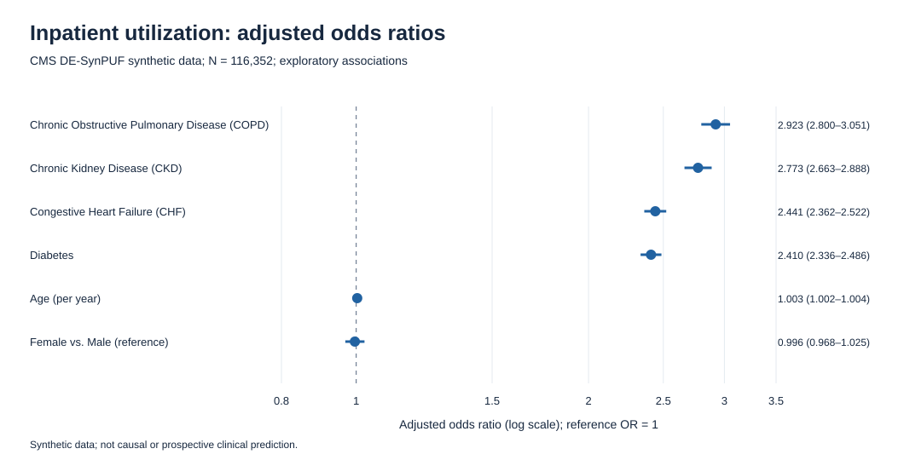

# Medicare Claims & Hospital Utilization Analysis

**Independent health data analytics portfolio project**  
**Dataset:** CMS DE-SynPUF synthetic Medicare claims (2008 beneficiary records and inpatient claim segments)  
**Skills:** Python, SQLite/SQL, R, relational data modeling, data integrity, logistic regression, visualization, model evaluation.

## Problem

How can raw segmented Medicare-style claims data be transformed into an auditable relational dataset to characterize inpatient utilization and test associations with demographic and chronic-condition indicators?

## Verified analytical outputs

| Metric | Result |
|---|---:|
| Beneficiary records | 116,352 |
| Inpatient claim-segment records | 66,773 |
| Distinct claim IDs | 66,705 |
| Beneficiaries with inpatient claims | 37,780 |
| Unmatched inpatient beneficiary IDs | 0 |
| Proportion with any inpatient claim | 32.47% |
| Mean distinct claims per beneficiary | 0.57 |

## Methods and deliverables

1. **Data profiling and quality checks:** inspect raw extracts, investigate repeated claim IDs and verify relational integrity.
2. **Relational database:** construct a SQLite dataset with beneficiary and inpatient segment tables.
3. **SQL reporting:** calculate beneficiary-level utilization, stratifications and chronic-condition comparisons.
4. **Exploratory statistical analysis:** multivariable logistic regression of any inpatient claim using age, sex and selected chronic-condition flags.
5. **Diagnostics:** reproducible seeded 80/20 train/test split, ROC AUC, Brier score and calibration-decile summaries.

### Exploratory model diagnostics

| Diagnostic | Value |
|---|---:|
| Training cohort | 93,081 |
| Held-out test cohort | 23,271 |
| ROC AUC | 0.7833 |
| Brier score | 0.1657 |
| Mean predicted outcome proportion | 0.3264 |
| Actual test outcome proportion | 0.3273 |

See [model methods](reports/04_model_methods.md), `reports/inpatient_model_diagnostics.txt`, and saved visualization outputs.

## Portfolio visualization: adjusted odds ratios and 95% confidence intervals



*Forest plot based on the verified regression estimates for six predictors. Synthetic Medicare claims data; exploratory associations, not causal effects.*

The [reproducible forest-plot R script](scripts/19_publication_forest_plot.R) displays six adjusted associations with horizontal 95% confidence intervals and a reference line at an odds ratio of 1.00. The plotting inputs are available in the [verified values table](reports/inpatient_forest_plot_verified_values.csv), and the [model documentation](docs/INPATIENT_MODEL_PORTFOLIO_NOTE.md) specifies the outcome, adjustment variables, sample size, and limitations.

| Predictor | Adjusted OR | 95% CI |
|---|---:|---|
| COPD | 2.923 | 2.800–3.051 |
| CKD | 2.773 | 2.663–2.888 |
| CHF | 2.441 | 2.362–2.522 |
| Diabetes | 2.410 | 2.336–2.486 |
| Age (per year) | 1.003 | 1.002–1.004 |
| Female vs. Male | 0.996 | 0.968–1.025 |

The female-versus-male interval contains 1.00. These estimates describe associations in synthetic data, not causal effects or prospective patient-risk predictions.

From the repository root, regenerate the forest plot after reproducing the model outputs:

```bash
Rscript scripts/19_publication_forest_plot.R
```

This creates `reports/inpatient_forest_plot_portfolio.png`, `reports/inpatient_forest_plot_portfolio.pdf`, and `reports/inpatient_forest_plot_verified_values.csv`. The render step has not been independently re-executed during this publication update.

## Key interpretation

In this synthetic sample, 37,780 of 116,352 beneficiaries (32.47%) had at least one distinct inpatient claim. Chronic-condition indicators were associated with inpatient claim status in an exploratory adjusted model, but the indicators may be claims-derived and overlap the outcome window. These associations do not establish causation, prospective prediction, or actual Medicare population rates.

## Reproduce locally

Requires appropriately obtained **CMS DE-SynPUF Sample 1** 2008 Beneficiary Summary and 2008-2010 Inpatient Claims CSV files, Python 3, and base R with PNG graphics support. Place the original files under `data/raw/` using the filenames expected by `scripts/01_audit_raw_data.py` and `scripts/03_build_database.py`. Do not commit the source files.

From the project root, first run the data audit, repeated-ID investigation, and database build:

```bash
python3 scripts/01_audit_raw_data.py
python3 scripts/02_investigate_claim_ids.py
python3 scripts/03_build_database.py
```

After SQLite is built at `data/processed/healthcare_claims.db`, run:

```bash
python3 scripts/04_prepare_model_data.py
Rscript scripts/05_inpatient_logistic_model.R
Rscript scripts/06_model_visualization.R
Rscript scripts/07_model_diagnostics.R
```

Verify record counts against the table above. The repository excludes source data, so a fresh reproduction depends on retrieving the same CMS sample files. The commands are documented but have not been independently verified from a clean environment. See `reports/04_model_methods.md` for scope and limitations.

## Scope and limitations

**CMS DE-SynPUF is synthetic, not a representative clinical study sample.** Its estimates do not describe actual Medicare utilization or health outcomes. The chronic-condition indicators are potentially claims-derived, so their timing and information content may overlap the outcome. The logistic regression and random holdout are **exploratory associations**, not prospective prediction or causal effects. ROC AUC and Brier score reflect the synthetic held-out data only. A deeper methodological review is needed before extending these findings.

The repository intentionally excludes downloaded raw files, derived beneficiary-level records, database files, and local IDE configuration.

**Author:** Sieanna Smith  
**Career focus:** Health Data Analytics | Public Health Informatics | Epidemiology
